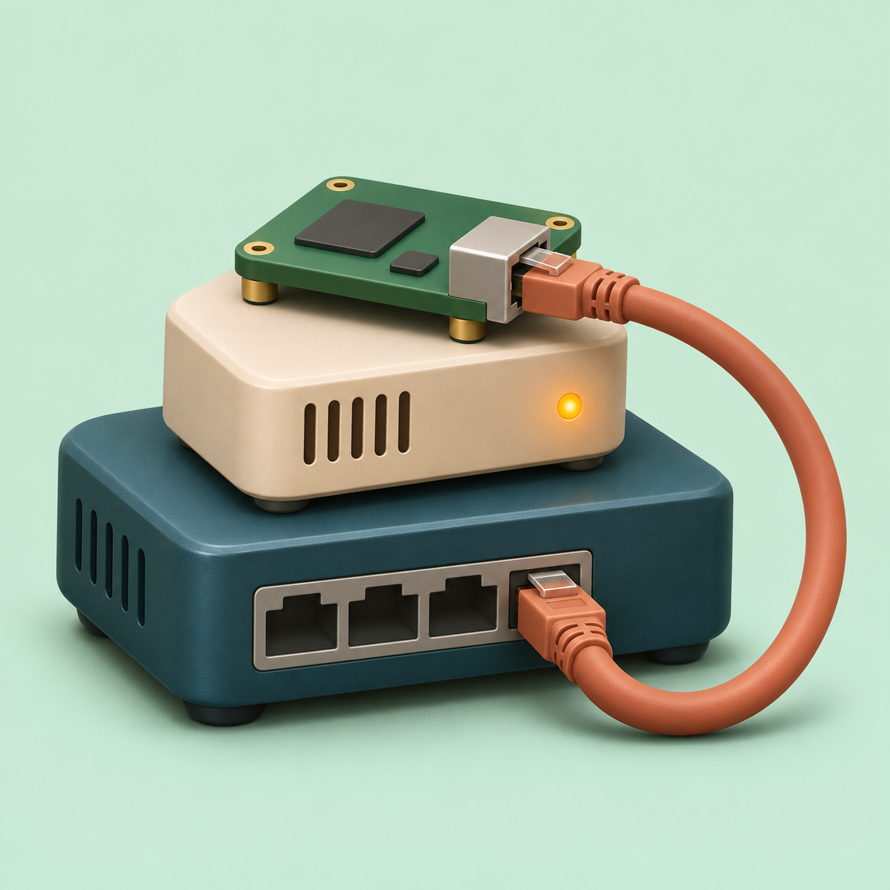

# Redh Control

<p align="center"></p>

Redh Control shuts down, wakes up and keeps an eye on the servers of the RedhWire homelab, from an
iPhone, an Apple Watch or a Mac. [PROJECT.md](PROJECT.md) is the original description. Its parts
are public on GitHub: [redh-control](https://github.com/BooneyNoobington/redh-control), this one;
[redh-api](https://github.com/BooneyNoobington/redh-api), RedhAPI, which every server needs; and
[redh-manager](https://github.com/BooneyNoobington/redh-manager), whose apps the server's page
shows where it runs.

| Part | What it is | State |
|---|---|---|
| [RedhAPI](https://github.com/BooneyNoobington/redh-api) | A small service on every server: its status, what the machine is doing, shutdown on request, and waking other servers up | 0.2; the servers run 0.1 until they're updated |
| [RedhKit](RedhControl/Packages/RedhKit/) | What the apps share: the setup, the clients for RedhAPI and the FRITZ!Box, the up/down guess | tested on macOS, builds for iOS and watchOS |
| [RedhControl](RedhControl/) | The apps for iPhone, Apple Watch and Mac, in SwiftUI | 0.1: the iPhone app in use; the Watch app runs on a real Watch, but its requests to RedhAPI fail with a TLS error so far; the Mac app runs. Being prepared for the App Store, as one listing: [AppStore.md](AppStore.md) |

RedhAPI's README holds the API contract that RedhKit follows.

## How it fits together

```
iPhone / Watch / Mac ──HTTPS──▶ Caddy ──▶ RedhAPI ──sudo──▶ redh-shut     status, shutdown
      │                                       ├─────sudo──▶ redh list     apps
      │                                       └─UDP broadcast─▶ server    wake-up, as its rooster
      │
      └──────HTTPS, TR-064──▶ FRITZ!Box ──Wake-on-LAN──▶ server           wake-up, "is it there?"
```

The logic of the apps is in RedhKit, which works as follows. The Watch gets its setup from the
iPhone; the Mac has one of its own.

- **Shutdown:** the app asks the server's RedhAPI. RedhAPI answers first and then runs
  redh-shut through sudo. A server that is the rooster of others (see below) warns first: while
  it's off, nothing else can wake them.
- **Wake-up:** a sleeping server can't answer, so the app asks the server's rooster to send the
  Wake-on-LAN packet. The rooster is a FRITZ!Box the server is connected to, asked over TR-064, or
  another server that stays on, asked through its RedhAPI. A Watch app can't send that packet
  itself, and an iPhone app could only with a special entitlement from Apple.
- **Up or down** is a guess from RedhAPI and the rooster:
  - RedhAPI answers: up;
  - Caddy answers but RedhAPI doesn't: up, RedhAPI down;
  - only the FRITZ!Box sees the server: probably up;
  - the FRITZ!Box doesn't see it, or the rooster server answers while the server doesn't:
    probably down;
  - nothing answers: unknown.
- **TLS everywhere, always verified:** Caddy gets its certificate from the homelab's ACME CA, and
  the app trusts that CA's root explicitly. Without a CA, RedhAPI serves HTTPS with a certificate
  of its own, which the app pins from the server's pairing code. Each FRITZ!Box's self-signed
  certificate is pinned when the app first connects to it.
- **Secrets** (tokens, FRITZ!Box passwords) live in the Keychain on the devices, never in this
  repository. The servers keep only hashes of their tokens.

## Licence

GPL-3.0, see `LICENSE`.
